# Lockout

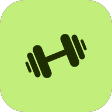

An offline strength training tracker for Android, rebuilt with Material 3 Expressive.

Plan your training, log sets, track food and follow your progress. Your routines,
workouts, meals, measurements and settings stay in a local SQLite database.
No account, ads, analytics or server.

**[Download the latest APK](https://github.com/CodeByLiad/lockout/releases/latest)** ·
[All releases](https://github.com/CodeByLiad/lockout/releases) · [License](LICENSE)

## Screenshots

Real captures from the Android app. Android's status and system navigation bars
are cropped out; the app's own navigation remains. Data shown is from a local
QA profile. These are screenshots, not generated design concepts. The gallery
was captured in v1.3.1/v1.4.0; v1.4.1 changes Progress to Saturday-first weeks
and adds the exact date range as described below.

| Today | Training | Live workout | Food |
|:---:|:---:|:---:|:---:|
| 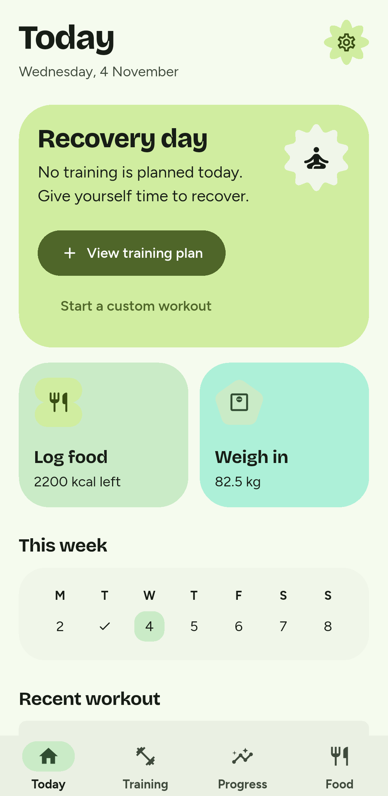 | 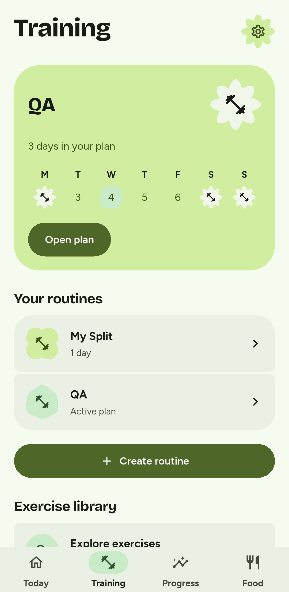 | 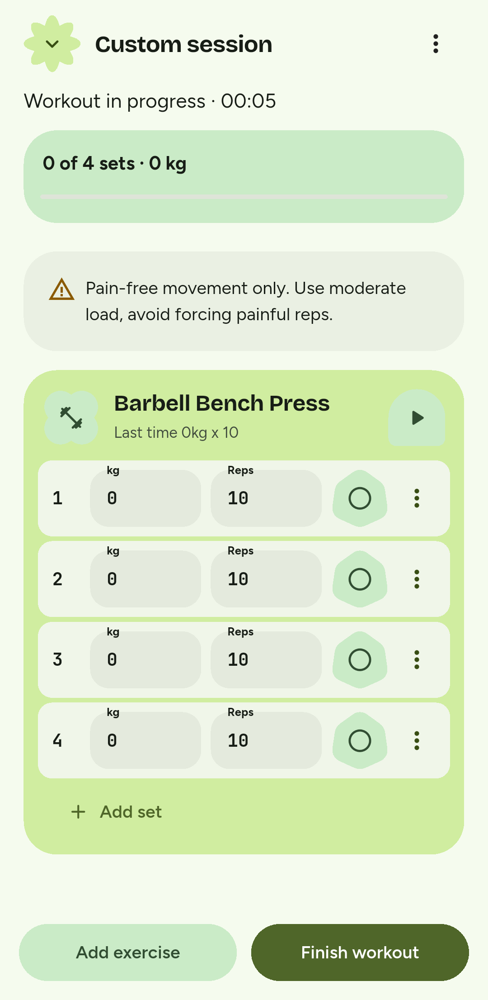 | 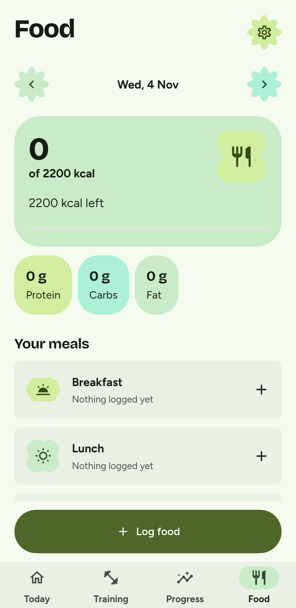 |

| Progress | Appearance | Today in dark mode | Training in dark mode |
|:---:|:---:|:---:|:---:|
| 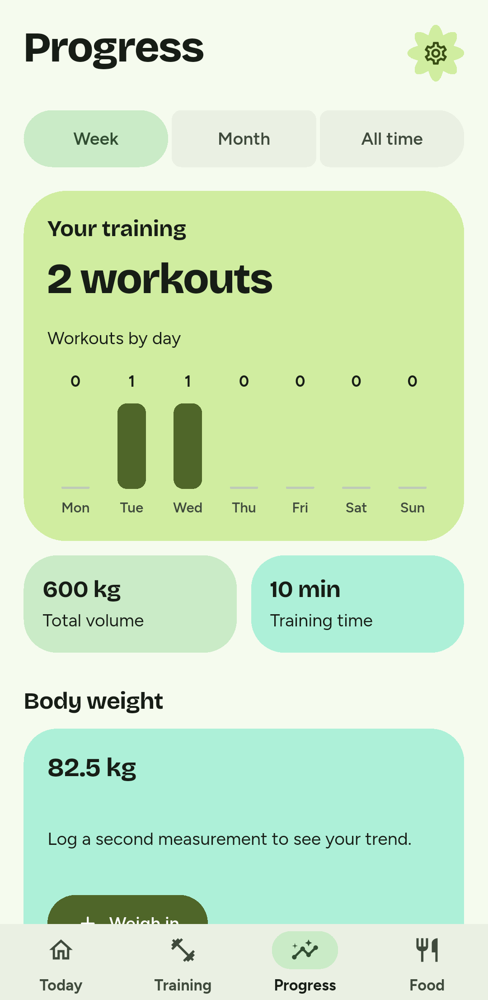 | 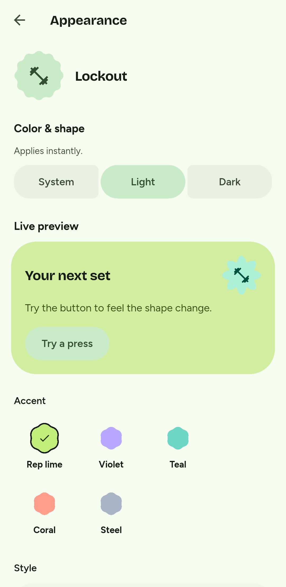 | 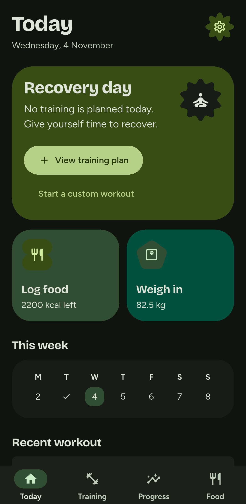 | 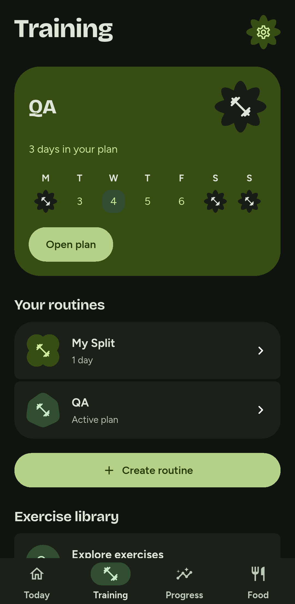 |

| First-time setup | Measurements | Review |
|:---:|:---:|:---:|
| 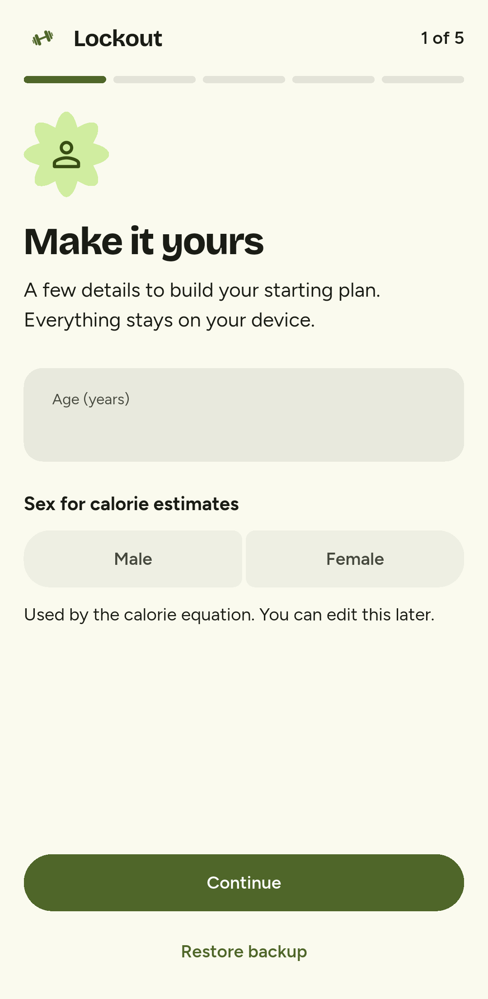 | 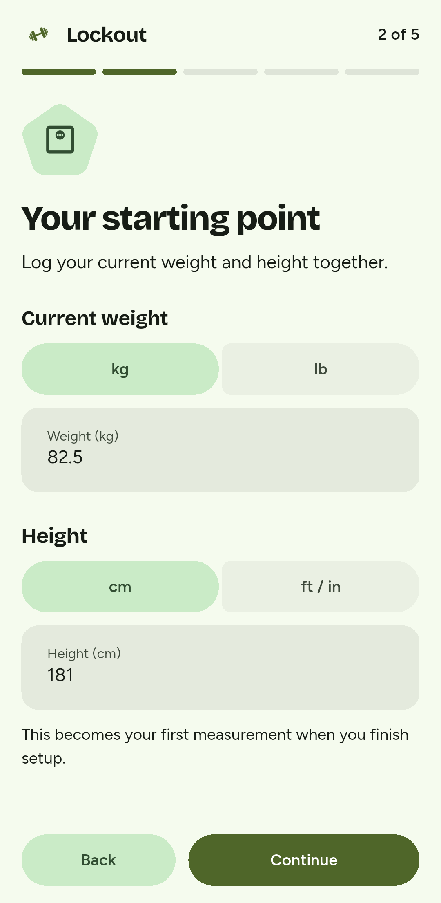 | 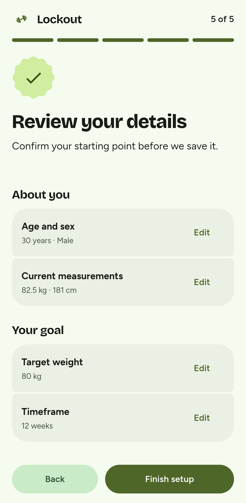 |

## What's new in v1.4.1

[Download v1.4.1](https://github.com/CodeByLiad/lockout/releases/tag/v1.4.1).

Progress now counts weeks from **Saturday to Friday**, with the chart in the same
order and the exact date range shown below the workout count. For example, a
workout on Sunday 8 November is included in the week of 7–13 November. Saved
workouts are preserved; this corrects the reporting boundary without rewriting
history. Install over v1.4.0 without uninstalling or clearing data.

## What's new in v1.4.0

[Download v1.4.0](https://github.com/CodeByLiad/lockout/releases/tag/v1.4.0).

- Required five-step profile setup: About you, Measurements, Goal, Activity and Review.
- Existing details prefill; interrupted setup resumes. Finish saves the profile and first weigh-in together without duplicates.
- Edit weight, height and goals together in Profile & goals. Units contains display preferences.
- Exercise labels stay inside filled fields. Embedded-video resource errors no longer falsely replace a usable page; an explicit external-video fallback is available.
- Existing data, offline operation and backup/restore are preserved. Notification popup behavior is unchanged.

## What's new in v1.3.1

**v1.3.1** adds the user-approved **The last rep** dumbbell icon, including round,
square, adaptive and monochrome formats, and permanent release signing for
future updates. [Logo assets](assets/branding) include vector masters and PNG exports.

- A whole-app Expressive rebuild: Today, Training, Progress and optional Food destinations, with focused settings and editors.
- Seed-generated color throughout. Choose light, dark or system brightness, one of five accents, and a tonal, vibrant or expressive scheme style.
- Distinct Material icon shapes, animated press/focus states, connected lists and filled inputs. Reduced-motion preferences are respected.
- Focused workouts with editable sets, automatic rest, minimize/resume, finish review and a saved summary. Only completed sets are archived.
- Clear setup, empty-plan, recovery-day and scheduled-training states. Custom routines always have a path to add their first day and exercise.
- Real period-based Progress charts, date-preserving food entry and kg/lb body inputs and displays.
- Labels grow for larger text instead of scaling down. Device checks include 360dp width at 1.5× text.

## Features

### Plan and train

Build a weekday schedule or rotating training cycle. Start from Push/Pull/Legs,
Upper/Lower, Full Body or a five-day body-part split, or create a custom routine.
Configure warm-ups, exercises, sets, rep ranges, working weights, rest intervals,
cues, finishers and explicit rest days.

Search the bundled exercise catalog by name, muscle or equipment. Add multiple
exercises to a day or create your own. Tap **Watch** for a form demonstration.

Today resolves the active plan's next action. Enter weight and reps directly,
mark sets complete, check previous performance and use the automatic rest timer.
Minimize a workout to visit another destination and resume without losing the
session. Review completed work before saving.

### Food, body and progress

Log meals from the bundled food catalog or enter custom food. Adjust portions
and review calories and macros by date. Edit without creating a duplicate and
undo deletion.

Track weight and waist, review measurement history and set a body goal. BMI
shows its calculation using stored height and weight. Calorie and macro targets
use BMR/TDEE and goal-planning calculations, with explanations and pace limits.
Display units convert at the input and presentation boundaries; weights remain
stored in kilograms.

Review workout history, completed sets, volume and time. Week, month and all-time
charts aggregate real local workouts. Missing data is explained rather than
filled with sample activity.

### Personalize and protect your data

Choose **Rep lime, Violet, Teal, Coral or Steel**, independently of brightness
and scheme style. The accent generates primary, secondary, tertiary and surface
roles in both light and dark modes. Expressive style keeps primary on the chosen
accent hue. There is no wallpaper-derived color.

Bricolage Grotesque, Figtree and JetBrains Mono are bundled for offline use.
Training reminders and optional streak warnings are scheduled locally, after
notification permission is granted.

Export your data to a JSON backup. Import validates the entire document before
restoring it in a transaction; malformed input leaves existing data untouched.
Database upgrades migrate in place.

## Privacy and permissions

The tracker works offline, with no background network requests. Exercise videos
and the About source-code link are explicit external actions; videos need
internet access. Backups leave the app only when you export/share them.

| Permission | Purpose |
|---|---|
| `INTERNET` | Exercise videos requested by tapping Watch |
| `POST_NOTIFICATIONS` | Optional local training reminders |
| `RECEIVE_BOOT_COMPLETED` | Re-arm local reminders after a restart |

## Build

### Updating an existing installation

v1.3.1 starts the permanent release-signing identity. Older published and local
debug-signed builds use different certificates, so Android will reject an
in-place update from those builds. **Do not uninstall before exporting a backup.**
Keep the exported JSON outside the app and confirm the file exists before
removing the old installation. Uninstalling removes its local data. Install the
new APK, then import your backup. A fresh installation needs no migration.

### Build from source

Validated with Flutter 3.47.2 / Dart 3.13.2 and the Android SDK.

```sh
flutter pub get
flutter run
flutter build apk --debug
# Configure private signing first; see docs/releasing.md
flutter build apk --release
```

The APK is written to `build/app/outputs/flutter-apk/app-release.apk`.
Prebuilt APKs are attached to [GitHub releases](https://github.com/CodeByLiad/lockout/releases).
This project's Windows setup uses `C:\src\flutter\bin\flutter.bat` by absolute path.
Release builds require private signing configuration and fail if it is missing;
they never silently use a debug key locally. The existing GitHub Actions
workflow produces disposable debug-signed test APKs without private keys;
those artifacts cannot update official releases. Official release APKs use
the permanent signing key.

## Tests and verification

Run tests serially because database suites share one SQLite file:

```sh
flutter test --concurrency=1
flutter analyze
```

The release passed **940 tests**, including launcher masks, backup round trips, migrations,
storage, units, theme persistence, contrast, navigation and new screen flows.
Analysis has no errors or warnings; two pre-existing test information notices
remain. Release-version checks also run before publication.

Native emulator checks cover representative light/dark flows, keyboards and
360dp width with enlarged text. All seven independent finish-review findings
were resolved. This does not certify every state on every device or a TalkBack
listening session. See the [release verification](docs/spine/qa/overhaul/release-v1.3.1.md)
and [UI verification record](docs/spine/qa/overhaul/verification.md).

## Architecture

```text
lib/
├── data/           # Bundled exercise, food and routine catalogs
├── models/         # Entities and SQLite row mapping
├── screens/        # Task destinations and focused routes
├── services/       # Local storage, scheduling, goals, units, backup and reminders
├── theme/          # Generated schemes, typography, shapes and motion
└── widgets/house/  # Nv component catalog used by rebuilt screens
```

Color, type, shape and motion resolve through the current theme and Nv catalog.
The [house design system](docs/design/nuvetrix-app-design-system.md) remains the
base contract, with approved deviations in the
[overhaul specification](docs/spine/specs/2026-11-03-whole-app-overhaul-proposal.md).
[DESIGN.md](DESIGN.md) documents the implemented native system.

## License

GPL-3.0-or-later. Published by Jinatra Ltd.
